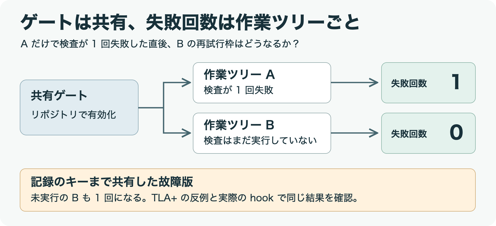

# dotagents

[](https://github.com/bwkw/dotagents/actions/workflows/ci.yml)
[](LICENSE)

**Claude Code・Cursor・Codex** のための個人用 AI 開発ツールキット。一度グローバルに入れれば、どのリポジトリでも使えます。プロダクトのリポジトリには一切手を入れません。

なぜこの形なのか（出典付き）: [docs/design.md](docs/design.md) · どの仕組みを選ぶか:
[docs/mechanisms.md](docs/mechanisms.md) · 判断の記録: [docs/decisions.md](docs/decisions.md) ·
ハーネスの実挙動（一次情報で確認）: [docs/harness-facts.md](docs/harness-facts.md) ·
1台のマシンへの依存を外した記録: [docs/portability.md](docs/portability.md) ·
完了条件・機能マップ・故障注入の再実行: [docs/verification.md](docs/verification.md) ·
外部スキルの採否と反証・比較評価: [docs/external-skills.md](docs/external-skills.md) ·
**ループの回し方: [docs/loops.md](docs/loops.md)**（実測は台帳が持っています —— `scripts/loop.sh report`）

何を配っているのかの正直な説明: [SECURITY.md](SECURITY.md) ·
直す前に読むもの: [CONTRIBUTING.md](CONTRIBUTING.md)

```bash
# ここに入っているのは、全ツール呼び出しと全ターン終了で自動実行されるコードです（SECURITY.md）
git clone https://github.com/bwkw/dotagents ~/private/dotagents
cd ~/private/dotagents
./scripts/setup.sh install --dry-run   # 何が起きるか確認
./scripts/setup.sh install
./scripts/setup.sh status
```

**Codex（ChatGPT デスクトップアプリ・Codex CLI）でも同じように使えます。** 違いは 2 つだけ:
スキルは `/da-verify` ではなく **`$da-verify`** と打つ（`/skills` で一覧）。そして **hook は Codex の `/hooks` で
一度信頼するまで動きません** —— 信頼しないと Stop ゲートも lint も黙って素通りします。スキルは 3 つとも
`~/.agents/skills` を読み、サブエージェントは `install` が `agents/*.md` から `~/.codex/agents/*.toml` を生成し、
hook は Claude Code と同じ定義を `~/.codex/hooks.json` に入れます（[docs/harness-facts.md](docs/harness-facts.md)）。

`install` は hook の配線と、`skillOverrides` / verbose なテレメトリまで入れます。**bundled / plugin
スキルを触らせたくないマシンでは `install --no-opinions`** で hook の配線だけになります。

必要なもの: `node`、`bash`、`git`。**macOS と Linux で CI が回っています**（bash 3.2 を含む）。Windows は
bash 前提なので WSL のみのはずですが、未確認です。Node.jsは24以上が必要です。推奨版は `.node-version` の24.22.1（LTS）で、CIは下限の24系列と推奨版を検証します。
ローカルでも利用中のNodeバージョン管理ツールで `.node-version` の版に揃えてください。

> **`profiles/` を1つ書くまで、検証ゲートは何も検査しません。** これは推測しない設計の帰結です
> （一致する profile が無ければ pass）。`profiles/_example.node-pnpm.json` をコピーするか、`/da-verify`
> に書かせてください。`setup.sh status` は profile が0件のとき警告します。

---

## 何をしたいかで選ぶ

Claude Code・Cursor では `/da-…`、Codex では `$da-…` で呼びます。依頼に続けて対象や期待を書くと、その仕事を担う入口が手法を選びます。

| やりたいこと | 入口 | 受け取るもの |
|---|---|---|
| 動作・経緯・障害の原因を知る | `da-investigate` | 実装、履歴、観測、一次資料に裏付けた答え |
| 設計する、仕様にする、所見を修正計画にする | `da-plan` | 未決の判断は面談で詰め、境界や順序が変わる案は画像で比較。記録を頼むと仕様・計画にまとめる |
| 機能を作る、不具合を直す | `da-implement` | 再現するテストから始めた変更と、利用者の入口での結果 |
| 設計書やPRの問題を見つける | `da-review` | 設計なら移行順や反例、差分なら各層と層の間を調べた所見 |
| 今の変更が出せるか確かめる | `da-verify` | プロファイルの検査結果、各完了条件の証拠と未確認事項 |
| 次の変更でも同じ失敗を検出できるようにする | `da-write-checks` | 実操作、生成入力、モデル検査、定理証明から選んだ再実行可能な検査 |
| 決定をADRに残す、既存ADRを図にする | `da-adr` | 決定・理由・捨てた案、または指定した図。資料の生成は内部の `x-present` が担当 |
| PRの本文やレビュー依頼を整える | `da-pr` | 読む順序と確認箇所が分かる本文、または対象PRごとのレビュー依頼文 |
| スキルの追加・廃止を判断する | `da-skills-audit` | 用途の重複・依存・予算と、置き換えてよい条件 |

**依頼例。** 「二重送信が起きる設計か見て」は `da-review`、「二重送信を直して」は `da-implement`、「この操作順が再発したら検出して」は `da-write-checks` で扱います。検査を実装の外にモデル化した場合は、モデル上の反例と実装での観測を分けます。実操作の動画は「この機能をCSに説明するデモ動画を作って」と依頼できます。動画・図のための公開コマンドを増やさず、同じ内部スキルが形式別の手順を選びます。

**図で確かめる例。** 「失敗回数はどこで持つ？」と `da-plan` に頼むと、前提を調べ、選択が必要な点を `grilling` で詰めます。下図は決定後の実装で、A の失敗が B の再試行枠を消費しないことを示します。[図の編集元](docs/figures/worktree-isolation.svg)・[モデルと hook の検査結果](docs/verification.md)



**旧名からの移行。** `da-spec`・`da-fix-plan` は `da-plan`、`da-design-review`・`da-review-all` は `da-review`、`da-pr-describe`・`da-greptile-review` は `da-pr` にまとまりました。`da-adr-figure` と `da-demo-video` の実行部は `x-present` にあります。配布済みのリンク・hook の更新には `./scripts/setup.sh install` を使います。

[ソフトウェアファクトリーの6事例と採用条件](docs/evaluations/2026-11-28-software-factory.md)・[全スキルの移行表](docs/superpowers/plans/2026-11-28-skill-architecture.md)・[検査と証拠の対応](docs/verification.md)

### ループで実装を進める

依頼からPRまで反復する場合は `scripts/loop.sh` を使用します。規模判定、検査、レビュー、修正計画、停止理由を台帳に残します。設計への合意とマージは人が行います。[具体的な操作](docs/loops.md)

| 段 | 判定 | 設計フェーズ | レビュー | 人間の位置 |
|---|---|---|---|---|
| **XS** | ≤5 files・1 layer・one-way 0・risk 0・unconfirmed 0 | 無し | **1周。triage と修正は無し** | ループの**上**。PR を読む |
| **S** | ≤10 files ／ **unconfirmed** | 無し | 1周 + triage + 修正 | ループの**上**。台帳を読む |
| **M** | ≤30 files ／ ≤2 layers ／ **risk surface** | `/da-review` を対話で | 2周 | 承認1回（= 計画を commit） |
| **L** | >30 files ／ 3 layers ／ **one-way door** | `/da-plan` で面談・仕様化 → `/da-review` | 2周 | ループの**中** |

**規模と不可逆性は別の軸です。** 以前は `risk surface` と `unconfirmed` も単独で L を出していて、**段が
崩壊していました** —— 実際のリポジトリでは backend の変更はほぼ必ず authorization に触るし、
`da-investigate` は確認できなかったことを挙げるのが仕事なので必ず何かを挙げる。結果として全部 L で、
無人で回るものが1つも無くなる。入力が全部同じクラスに落ちる分類器は、分類していません。詳細と、
それぞれが「厳しすぎた」ではなく**間違っていた**理由は `docs/loops.md`。

**無人で端まで回るのは XS と S です**（実際に端まで閉じた1本は **XS** でした）**。** `da-plan` の面談には回答する人が必要で、`da-review` の Step 1 は
「Show this to the user」—— どちらも相手が要ります。上2段は「人間が入る設計フェーズ」＋「無人の実装ループ」。
そして**判定は bash の算術**です: モデルが測り、表の適用はスクリプトがやる。「規模に応じて」と
書いてモデルに選ばせると毎回最大値になる（ファンアウト予算で実際に起きたこと）。

**PR は landing ごとに1本、[GitHub の stacked PR](https://docs.github.com/en/pull-requests/get-started/about-stacked-prs)
にします。merge は人間のものです。** 以前ここには「PR の作成とマージは自動化しません」と書いて
ありました —— [判断の記録](docs/decisions.md) に反転として残しています。

**landing は構造上すでに stack です**（landing 2 は landing 1 の上に建つ）。
`gh stack submit --auto --open` が走るのは、ゲート全緑・Fix now 0・判断待ち 0・VERDICT 無し・
一方通行でない・ツリーがクリーン・採点器に触っていない・**この stack の open PR が5本未満**の
全部が揃ったときだけ。最後の1つは、エージェント PR の reject 理由の最大バケットが
「誰も関わらなかった」だからです —— **人間の読む速度が律速だと認めた上限**です。

`--open` が要るのは、`gh stack submit` が既定で draft を作るからです。この層は既にゲートを通り
レビューを1周しているので draft ではありません。**`gh extension install github/gh-stack` が前提**で、
無ければ止まります —— `gh pr create` に落ちると全 PR が trunk に並び、**頼まれたのと違う形の出力を
黙って出す**ことになるので。**merge は自動化しません。** `da-plan` は今も「push も issue も
コメントもするな」と明記しています。

### どのコマンドより効く3つの規則

- **差分を1文で説明できるなら計画は飛ばす。**
- **計画と実装の間で `/clear`**、そして無関係なタスクの間でも。
- **同じ問題で2回修正に失敗したらセッションを捨てる。** 学んだことを織り込んで prompt を書き直す。失敗したアプローチを抱えた長いセッションより、良い prompt の綺麗なセッションが勝つ。

理由・出典・良い出典どうしが食い違う箇所は [`docs/design.md`](docs/design.md) に。**正典と呼べる段階数は存在しない**という事実も含めて —— 上の5ユースケースは便宜であって、発見ではありません。

### ゲートと、直接触る場合

`/da-verify` が最初のステップでゲートを arm するので、**上のどのユースケースにも別途 arm するステップはありません。** arm 後はターン終了ごとにこのリポジトリのチェックが走り、赤い間は終了を拒否します。

```bash
scripts/gate.sh arm            # まだ verify が走っていない段階から、最初のターンから保留したい
scripts/gate.sh disarm         # 質問応答に戻る。終了時にスイートを走らせたくない
scripts/gate.sh status         # armed か、どれだけ idle か、諦めた記録があるか
scripts/gate.sh status --json   # 同じ内容を、人間ではなくドライバ向けに
scripts/gate.sh gc             # 終了したセッションが残した armed 状態を回収する
```

### ループを回す

詳細は [docs/loops.md](docs/loops.md)。引数なしの `scripts/loop.sh` が同じ一覧を印字します。

> **端まで閉じました。1本だけです。** 駆動系が自分で開いてマージされた landing が1つあり、
> `findbugs` の段は**まだ一度も走っていません**（下の「どう動かす想定か」がその理由）。
>
> **数字はここに写しません。** 走るたびに変わるので、写した時点から古くなります ——
> `scripts/loop.sh report` が今の内訳を、`bash scripts/check.sh` が今のテスト結果を出します。
> この段落は「まだ一度も実走していません／105件緑」と書いたまま**複数日の実走に追い越され**、
> 次は「PR に到達した run は1本もない」と書いたまま**到達に追い越され**ました。
> **計器を作ったことは測ったことではなく、測ったことは閉じたことでもありません。**

#### どう動かす想定か

**このリポジトリは、ループを回して仕事をする場所ではありません。** 規則3が採点器
（`scripts/loop.sh`・`profiles/`・`hooks/`）を守るので、ループに許された領域は `skills/` `docs/`
`agents/` `templates/` と直下の Markdown だけです。**そこには money・認可・PII・移行・並行性が
存在しえないので `risk_surfaces` は構造的に常に 0 になり、`findbugs`（2人目のレビュア）は永久に
走りません。** 題材の選び方の問題ではないので、**仕事として回すのは製品リポジトリです。**

**ここで回すのは駆動系を直すときだけで、そのときの生産物は landing ではなく駆動系の欠陥です。**
**1回の実走が、テストでは原理的に出ないものを毎回1つ以上出します** —— 連続でそうなっています。
比を見るなら `report` の `cost per accepted` と `halted` の内訳を読むこと。

**人の手番は3つだけです。**

| | |
|---|---|
| **マージを押す** | `gh pr merge` は権限分類器が止めます。駆動系は PR までしか行きません |
| **レビュー報告を読む** | tier XS は triage を落とすので、所見は `$LOOP_DIR/reviews/` に残るだけ。**「止まらなかった」は「問題が無かった」ではありません** |
| **天井を上げる前に依頼を狭める** | `size` が切られたら、まず依頼文に検証すべき主張を詰め込んでいないか見ること。**自分の冗長さに合わせて天井を上げるのはゴールポストを動かすのと同じ** |

**壁時計は、その周が何を触るかで決まります。** docs だけの周はゲートが数秒で終わり、
`scripts/loop.sh` を触る周は10分前後（ほぼ全部 `loop-tests`）。**`MAX_ROUNDS=3` なので最悪はその3倍**
—— 数字と経緯は [`docs/decisions.md` §29](docs/decisions.md)。

**前提が2つあります。**

```bash
gh extension install github/gh-stack   # landing ごとに1本の stacked PR にするので
claude setup-token                     # 無人ループには期限切れしない資格情報が要る
```

2つ目は運用要件です。**OAuth トークンが実行中に切れると、`claude -p` は無人では絶対に得られない
ログインを待って止まります** —— 有界化してあるので**ハングはしませんが landing は止まります**
（`halt_reason: round_timeout`）。

#### 打つのは1つだけ

```bash
scripts/loop.sh "やりたいことを1文で"
```

**同じコマンドを打つたびに1歩進みます。** 何が次の段かを覚える必要はなく、計画ファイルのパスも
覚える必要はありません（`docs/plans/` から自分で見つけます）。

| いまの状態 | このコマンドがすること |
|---|---|
| まだ測っていない | 測って tier を出し、**そのまま次へ** |
| tier **S** | **端まで回す。** worktree 隔離 → arm → TDD → レビュー → triage → stacked PR |
| tier **M・L**、計画がまだ無い | **「ここからはあなたの手番です」と言って止まる。** 順序と、何が検証できているかを印字（exit 0 —— 失敗ではなく引き継ぎ） |
| tier **M・L**、計画が commit 済み | 計画を**自分で見つけて**端まで回す |
| `docs/plans/` に計画が2つ以上 | **推測せず両方を並べて止まる** |

つまり大きい変更はこうなります —— **打つのは同じ1行、2回だけ**です。

```bash
scripts/loop.sh "認証を OIDC に寄せる"
#   → tier L。「あなたの手番です」と順序が出る

#   あなたが打つ: /da-plan で設計を固める → /da-review
#   🧱 Landing plan を docs/plans/ 以下に保存して commit  ← これが承認の印

scripts/loop.sh "認証を OIDC に寄せる"
#   → 計画を見つけて、端まで回す
```

**走っている間、あなたは何もしません。終わったら台帳を読みます** —— transcript ではなく。
止まったときは `halt_reason` が理由を1語で言い、**全部「人間に返す」で終わります**。

下の個別サブコマンド（`size` / `design` / `run` / `report` / `status`）は残してありますが、
**普段打つ必要はありません。** `report` だけは自分で打ちます —— 数字は読まないと意味がないので。

PRの説明は `da-pr` に頼めます。小さな修正は「何が変わるか」「どこを見ればよいか」を2〜3行で。順序や境界が判断を左右する場合は、確認してほしい経路を PNG で1枚添えます。本文更新を頼むと、対象PRを読み戻して反映を確認します。[実際の差分を使った本文例](skills/da-pr/reference/pr-template.md)

```bash
scripts/loop.sh "やりたいことを1文で"        # ← 普段打つのはこれだけ。状態を見て1歩進む
scripts/loop.sh report                      # 採択1件あたりのコスト、phase 別の内訳

# 個別に触りたいとき（普段は不要）
scripts/loop.sh size "…"                    # 規模だけ測る
scripts/loop.sh design                      # 設計フェーズの順序と、検証できているもの
scripts/loop.sh run [<landing-plan>]        # 回すだけ
scripts/loop.sh status                      # 直近の size 判定と、ゲートの状態
```

> **`report` が出す数字は1つが最重要です: 採択1件あたりのコスト。** 採択率が 50% を下回ったら
> ループは負けています（レビュー作業を人間に押し戻しているだけ）。`report` はそのとき自分でそう言います。
> **スキル単体のコストは実測しました**（`/da-review-all` **$1.99** · `/da-verify` $0.59 ·
> 自明な1ターン $0.09）—— [設計思想](docs/design.md) が「今あるのは自己申告だけ」と書いていた
> ギャップの片側。**ただし「採択1件あたり」はまだ0件のデータに対する数字です。**

> **無人で回しても壊れない形にしてあります。** 以前ここには「深夜に無人で回すためのロックではありません」と書いてありました。**その立場が誤りだったのではなく、立場の話をしている間に状態機械が壊れていた**のが問題でした —— `arm` に期限が無く、ブロックに上限が無く、諦めたことが記録されない。[判断の記録](docs/decisions.md) に反転として記録しています。
>
> **gate が armed でなくなるのは2通り**: `disarm` と、**12時間ターンが終わらなかったときの自動回収**（idle 基準。arm からの経過ではないので、長時間の無人実行は途中で切れません）。**ブロックをやめるのは3つ目の出来事** —— 同じチェックが3回落ちると `VERDICT` を書いて解放します。**解放は緑ではありません**: `status` と `verdicts.log` と次の `arm` が「諦めた」と言い、作業は未検証だと明言します。
>
> **worktree は継承します。** `using-git-worktrees` がこのツールキット自身の推奨する分離手段なので、main で arm すれば linked worktree にも掛かります。attempt 数は worktree ごとに別です。
>
> **Cursor ではブロックできず**、nudge するだけで3回目に止めます。そして**拒否し続ける hook は前進ではない** —— だから上限があります。セッションを越えて残るのは**ディスクの spec、CI のチェック、復帰点としてのコミット、そして `VERDICT`** です。

## 何が入っているか

dotagents は目的別の入口とプロジェクトごとの判断を持ち、TDDやデバッグの手順には[上流のスキル](#上流のスキル)を使います。

読み取り専用のサブエージェントは2つです。`x-codebase-explorer` が根拠のある場所と依存を調べ、`x-review-verifier` がレビュー所見を反証できるか確かめます。`setup.sh install` は Claude Code と Cursor には定義へのリンク、Codex には対応する TOML を配置します。[ホストごとの実際の配置](docs/harness-facts.md)

## 面の全体と、何を抑制しているか

Claude Code と Cursor は `/da`、Codex は `$da` で公開スキルを選べます。内部の `x-*` は、層別レビュー・資料生成・サブエージェント用です。単一層の無人レビューでは、ループがその層のスキルを直接呼びます。

### 面の実際の大きさ

ホストのメニューは、共有ディレクトリのスキルに組み込み・プラグインを加えたものです。公開入口は[目的別の表](#何をしたいかで選ぶ)、ホストごとの検出方法と設定の違いは[仕組みの比較](docs/mechanisms.md)で確認できます。

### 抑制しているもの、そしてなぜそれ以上やらないか

`skillOverrides` で8件を `name-only` か `off` に。`install` がマージし、`uninstall` が正確に戻します。**`install --no-opinions` を付けたマシンでは入りません**（既定を on に戻した理由は [判断の記録 §20](docs/decisions.md)）: `claude-api`（このリポジトリの作業で常に該当するトリガで自動発火する）、`anthropic-skills:schedule`（**`schedule` という名前のスキルが2本生きている**）、office 系 `docx`/`pptx`/`xlsx`/`pdf`（description が長く開発ループ外）、`morning`/`setup-cowork`。

**レビュア系は意図的に抑制していません。** 使用ログではバンドル `code-review` が42回、`review` が24回 —— 実際に使われています。そしてレビュアの多様性は、手に入る中で最も裏付けのあるレビュー手法です。`disableBundledSkills` なら一撃で全部消え、しかも **CLI 2.1.219 以降にしか存在しない**ので `$PATH` の古い `claude` では黙って無効になります。このマシンには両バージョンが入っています。[判断の記録 §8](docs/decisions.md) 参照。

### なぜ「コマンド」ではなく全部スキルなのか

公式がコマンドをスキルに統合し、素の `commands/*.md` が好ましいケースは公式に1つもない —— なのでここに `commands/` ディレクトリはありません。分類の全体像と出典は [`docs/mechanisms.md`](docs/mechanisms.md) にあります。

そこから出てくる運用上の帰結:

- **`/da` を打てば自作のものだけが1つのリストに出ます。** 2つ目の異なる呼び出し方は存在しません。
- プロンプトテンプレートの用途は今 `disable-model-invocation: true` という綴りで、**description が context から完全に消えるので予算コストがゼロ**です。人が専用の名前で呼ぶ上流スキルに使われています。
- 逆に **`/da-verify` と層別3本には絶対に付けません** —— **名前で**到達されるものなので、付けるとディスパッチが**無言で壊れます**。lint hook とリンタの両方がテスト付きで強制しています。
- 直接呼び出しと `/da-review` からのディスパッチを1本で兼ねられることが、層別をスキルにしている理由です。コマンドなら2ファイルに分かれて乖離していく —— このリポジトリの前身が実際にそう腐りました。参照セットは symlink で共有しているので、**規律を1箇所直せば全層と層をまたぐパスに同時に届きます**。

### frontmatter ガード

`hooks/dotagents-lint-skill-frontmatter.sh`、両エージェントで動きます。**頼まなくても遭遇する唯一の hook** です —— `Write`/`Edit` のたびに走り、パスが `SKILL.md` で終わるときだけ反応します。

スキルを書いていて編集が**拒否された**ら、理由はこれです。

| 拒否する条件 | 理由 |
|---|---|
| `name` か `description` が無い | メニューには出るのに一度も発火しない。他にそれを報告するものが無い |
| `---` で開いて閉じていない | 同じ失敗で、より気づきにくい |
| `da-verify` に `disable-model-invocation` | ゲートを arm する唯一のものなので、ガードレールが開く |
| 層別レビューに `disable-model-invocation` | `da-review` がその層を「カバー済み」と報告して何もレビューしなくなる |

「何をするか」は書いてあるが「**いつ使うか**」が無い description は、**拒否ではなく確認**になります —— 打てば動くが、自動では発火しないので。それ以外は通します。この hook は検査だけなので落ちたら**開いて**通します。閉じて止まらなければならないのは下のゲートです。

### 検証ゲート

`hooks/dotagents-verify-gate.sh`、両エージェントで動きます。

**センチネル方式。** `gate.sh arm` するまで何もしません。常時ONのゲートは、質問に答えるだけのセッションの終わりにもテストスイートを走らせるので一日で切られます。それは無いより悪い。`gate.sh arm` は profile が無いとき警告します —— 走らせるものが無いゲートは「有効」と表示しながら全部通すので。

**コマンドは profile から引きます。** git remote で照合するので、プロダクトのリポジトリは無改変です。`agent_may_run: false` のチェックはエージェントが決して実行せず（そう文書で定めているリポジトリがあるため）、**あなた自身の出力**を要求します。profile が無ければ推測せず黙ります —— 見知らぬリポジトリで勝手に `npm test` を叩くのは、検証ツールが信用を失う典型です。

**Codex では Claude Code と同じく止められます**（`/hooks` で信頼した後）。**Cursor でも走りますが、ブロックできません。** Cursor の `stop` フックには拒否の仕組みがなく、代わりに follow-up メッセージを自動投入します（`loop_limit` で打ち切り）。両フックは呼び出し元を判定して適切な方言で応答します。Cursor 側は「強い促し」と考え、重要な場面では `/da-verify` を明示実行してください。対応表は [判断の記録 §3](docs/decisions.md)。

**何も起きていないように見えたら** `~/.claude/.dotagents-gate/trace.log` を読んでください。全ての呼び出しと、通した理由が記録されています。「何も起きなかった」には正当な原因が6通りあり、このファイルがそれを区別します —— 一度これが無いまま推測して、**動いているコードを変えて原因を隠しかけた**ので作りました。

### プロファイル

[`profiles/dotagents.json`](profiles/dotagents.json) を `profiles/<repo>.json` にコピーして書き換えます。**注釈だけの `_example.json` は削除しました** —— `docs/design.md`「未確定なこと」自身が「example は書き始めを助ける以上に書き方を狭めているかもしれない」と挙げていたもので、しかも**何も実行しない例**でした。残したのは schema と、**このリポジトリ自身のゲートが毎ターン実行している唯一の実例**だけです。

**あなたのコピーは gitignore されます。** profile は実在のリポジトリ名・環境名、場合によっては勤務先の社内ルールを含むので、書いたマシンに留まります。`.gitignore` は許可リスト方式なので、新しい profile は**デフォルトで untracked** です（「除外し忘れるまで追跡される」の逆）。`/da-verify` が書き方を案内します。

### 仕組み

```
dotagents/skills/<name>/
        ↑ symlink
~/.agents/skills/<name>          ← Cursor と Codex はここを直接読む
        ↑ symlink
~/.claude/skills/<name>          ← Claude Code は symlink を追う
```

実体はひとつ。ここを編集すれば同期の手順なしに 3 つのエージェントへ反映されます。リンクを張るのは Claude Code 側だけ —— Cursor が `~/.agents/skills/` を読むことは**推測ではなく観測**です（[判断の記録 §1](docs/decisions.md)）。

フックだけは **実体コピー**です。symlink が切れると `exit 127` になり non-blocking として扱われるため、**ガードレールが「止まる」のではなく「開く」**からです（[判断の記録 §2](docs/decisions.md)）。

---

## 上流のスキル

### 標準の依存

自作の入口にはプロジェクトごとの判断を置き、実装・調査の方法論は上流で保守します。`scripts/setup.sh status` が不足を報告します。リポジトリ全体を取り込まないように、名前を `-s` で指定します。

```bash
# 方法論 — obra/superpowers
#   後半4本は前半が REQUIRED SUB-SKILL / 代替として名指ししている依存。
#   subagent-driven-development は writing-plans が必須と宣言するので入れますが、
#   このリポジトリの駆動系は打ちません（docs/loops.md に理由）。
npx skills@1.7.4 add obra/superpowers -g -a claude-code -a cursor \
  -s writing-plans -s executing-plans -s receiving-code-review \
  -s systematic-debugging -s test-driven-development -s using-git-worktrees \
  -s finishing-a-development-branch -s verification-before-completion \
  -s subagent-driven-development -s requesting-code-review

# 実務 — mattpocock/skills
#   包み紙の grill-me ではなく、実体の grilling を直接入れます（判断の記録 §38）。
npx skills@1.7.4 add mattpocock/skills -g -a claude-code -a cursor \
  -s grilling -s research

# セキュリティ — getsentry/skills
npx skills@1.7.4 add getsentry/skills -g -a claude-code -a cursor \
  -s find-bugs -s skill-scanner
```

### 用途に応じて入れるもの

設計改善には `improve-codebase-architecture` と設計語彙を、振り返りには `retro` と必須の `writing-for-agents` を組み合わせます。`statechart` はTLA+の検査結果を図にする時、`correct` は過去に繰り返した失敗を構造・型・検査で防ぐ時に使います。以下から必要な組だけを選びます。

```bash
# 設計・試作・設定案内・振り返り — 監査した上流コミット
npx skills@1.7.4 add https://github.com/mattpocock/skills/tree/5beb35b040e3de97e54fa9e386d7e42d15c295c2 -g -a claude-code -a cursor \
  -s retro -s writing-for-agents -s prototype -s wizard \
  -s codebase-design -s improve-codebase-architecture -s domain-modeling

# 対話的な図解 — 監査・生成検証した安定版
npx skills@1.7.4 add https://github.com/tt-a1i/archify/tree/v3.2.0 -g -a claude-code -a cursor -s archify

# pstack — 状態図の検査、または繰り返したミスの再発防止。必要な名前だけ指定する
npx skills@1.7.4 add https://github.com/cursor/plugins/tree/bf0c7cd80abdbf7fe47b634978a7d1b4071f71a7/pstack -g -a claude-code -a cursor -s statechart -s correct
# 選択コピーに含まれない上流ルートの著作権表示も保存する
mkdir -p ~/.agents/.skill-licenses/cursor-plugins-pstack
curl -fLsS https://raw.githubusercontent.com/cursor/plugins/bf0c7cd80abdbf7fe47b634978a7d1b4071f71a7/pstack/LICENSE \
  -o ~/.agents/.skill-licenses/cursor-plugins-pstack/LICENSE

# 視覚設計 — Anthropic 公式の監査したコミット
npx skills@1.7.4 add https://github.com/anthropics/skills/tree/dbd4588f9e1033efb41dad4bef2f7947c8993d44 -g -a claude-code -a cursor -s frontend-design
```

来歴調査、依頼文の推敲、性能値の点検、実操作の検査の作成・保守、ADR は自作の入口に統合しました。設計上の廃止候補6本と、移行前に確認する機能は[採否表](docs/superpowers/plans/2026-11-28-skill-architecture.md)を参照してください。すでに個人が導入した第三者製スキルは `setup.sh` の管理外です。

上流は導入前と更新時に取得元・固定版・依存を確認し、`skill-scanner` を使って対象を検査します。削除する場合は他のスキルやループからの参照を確認し、共有側の実体・Claude側のリンク・ロックファイルを照合します。[外部スキルの採否と評価](docs/external-skills.md)・[pstack の監査と使用例](docs/pstack.md)

## スキルの書き方

[`_template/SKILL.md`](_template/SKILL.md) から始めて `./scripts/verify-skills.sh`。

不変則は [`AGENTS.md`](AGENTS.md) にあります —— あれが常時ロードされる層で、**無警告で失敗する**ものだけを置いています。全体を規定する1つ: **Claude 固有の frontmatter を全部剥がしても同じ挙動が成立すること。** Cursor はそれらを何も言わずに無視し、しかも**別のモデルファミリー**で動くので。

## スクリプト全部と、それを正当化する理由

配布・ゲート・検査に使う主なスクリプトと、それぞれが防ぐ失敗をまとめます。

| ファイル | なぜ存在するか |
|---|---|
| `scripts/setup.sh` | **配布の機構。** スキルと agent を link、hook をコピー、設定をキー単位でマージ、リポジトリが配らなくなったものを prune、追加したものだけを正確に revert。これが無いと何もインストールされない |
| `scripts/lib/merge-settings.mjs` | その安全な半分: 宣言したキーだけをマージし、自分が書いていない値は書き換えず、触ったものを記録する。**他人の API キーを含むファイルを編集する**ので |
| `hooks/dotagents-verify-gate.sh` | **ゲート。** 価値提案の本体 —— エージェントは「完了したように見えた」時点で止まる |
| `hooks/dotagents-lint-skill-frontmatter.sh` | **壊れた状態でインストールされて何も言わない** `SKILL.md` を拒否する |
| `scripts/gate.sh` | ゲートの操作面: arm / disarm / 委譲チェックの記録 / 状態表示。通常はあなたではなく `/da-verify` が呼ぶ |
| `scripts/verify-skills.sh` | `AGENTS.md` の不変条件をチェックに落としたもの。**実際に捕まえた**: どの YAML パーサも受け付けない frontmatter、本文が使うツールを欠いた `allowed-tools`、本文から言及されていない reference、到達不能な `user-invocable: false` |
| `scripts/test-verify-gate.sh` | **ゲートは唯一「閉じて落ちる」ことが必須のもの**で、これが無かった時代に2回 fail-open した |
| `scripts/test-lint-hook.sh` | **このリポジトリ最悪のバグを捕まえた**: scope チェックが誤った変数を見ていて**一度も発火していなかった** —— インストール済みで、何も強制していない状態 |
| `scripts/test-setup.sh` | 偽の `$HOME` に対して。インストーラは**資格情報と他ツールの hook を含むファイル**を編集する |
| `scripts/verify-halt-docs.sh` | **停止理由の表とコードが同じ集合であることを主張する。** 実際に **7値ぶん黙って乖離**していた（`ci_pending` で止まった run の理由が、人を送り込む先の表に無い）。3方向を見ます: 駆動系が出せる理由に行があるか／行が存在しない停止を説明していないか（`review_cap` は台帳の古い行のために**宣言して**残す）／**台帳に入らない4つに印が付いているか**（`halt()` は stderr だけ、台帳を書くのは `record()` の第5引数）。宣言は `docs/loops.md` のマーカー行にあり、**消せば通るのではなくエラー**になります |
| `scripts/check.sh` | 上記すべてを1コマンドに。**5つ覚える代わりに1つ** |
| `scripts/handoff.sh` | 次のセッションへの引き継ぎを**状態から生成**する。git・台帳・`gh` から取るので陳腐化しません —— **未 commit・未 push・main に入っていないローカルブランチ**を先頭で警告するのは、3つとも実際に見失ったことがあるため。手書きの「持ち越し」節は撤廃しました（写しの方が古くなるので） |
| `scripts/test-non-interactive.sh` | **人間を待つものが1つも無いことを主張する。** `--non-interactive` フラグは作りません —— 設定時にだけ通る第2の経路ができ、既定の経路がプロンプトへ退行してもフラグ付きテストは緑のままになる。実際に**stdin を閉じるとゲートがハングする**バグを見つけた（ハングすればハーネスに殺され、それは non-blocking = fail-open） |

**削除したもの（同じテストに落ちた）:**

| 削除 | 理由 |
|---|---|
| `hooks/dotagents-statusline.sh` ＋ template ＋ `--statusline` | **一度もオプトインされなかったオプトイン。** 72行とインストーラの関数を使って、誰も求めていないステータスラインを描画していた。しかも「全 hook はブロックできなければならない」チェックに**例外を強制**していた —— ブロックできない唯一の hook だったので |
| `templates/claude.advisor.snippet.json` ＋ `--advisor` | 同じく**一度も有効化されなかった**。しかも背後の機能は experimental で Anthropic API 専用なので、**大半の環境に存在しない能力**をフラグが説明していた |

両方に共通するパターン: **一度も ON にされなかった、何かのためのオプション。** ツールキットの所有が煩わしくなる原因は**ファイル数ではなく**、「保持するか判断する前に、まず目的を再構成しないといけないファイル」です。ここにあるもので**「何を防ぐか」を1行で答えられないものは、同じように消すべき**です。

## テスト

```bash
./scripts/check.sh              # 構文、リンク、スキル、動作、検査後の作業ツリーを確認
./scripts/check.sh --fast       # 構文と lint だけ
```

個別に走らせるのは、そのどれかを触っているときだけ: `verify-skills.sh`（lint）、`test-verify-gate.sh`、`test-lint-hook.sh`、`test-setup.sh`、`test-non-interactive.sh`。**assertion 数は書きません** —— 手で維持する数はコミットごとに古くなり、stale な記述を欠陥として扱うリポジトリではそれ自体が欠陥です。

CI は両スイートを **Linux と macOS の両方**で走らせます。壊れ方が両方向に出たからです —— bash 4 構文は Linux で通り macOS で落ち、`mktemp -t` の綴りは BSD で通り GNU coreutils で落ちる。

実テストを持つのはゲートとインストーラだけで、理由は正反対です。**ゲートはフェイルクローズでなければならない** —— 見つかった全てのフェイルオープンに回帰テストがあります。**インストーラは自分のものでないファイルを編集する** —— 他人の資格情報と他人のフックを含むので、テストは「書いていない秘密が生き残る」「他3ツールのフックが生き残る」「uninstall が何も残さない」を固定しています。

## シークレット

ここには何も秘密を置かず、インストーラは自分が書いていないものに触りません。テンプレートが宣言したキーだけをマージし、`~/.claude/.dotagents-managed.json` に記録し、先にバックアップを取り、自分のものでない既存値は書き換えません。既存フックは置換ではなく追記です。

`uninstall` が戻すのは各キーの**値**であって、ファイルの**バイト列**ではありません。設定は固定の整形で書き直されるので、別の整形をしていたファイルは整形され直します。`test-setup.sh` が検証しているのは値であり、それが正直に約束できることです。

CI では gitleaks を全履歴に対して走らせています。

## ライセンス

[MIT](LICENSE)
