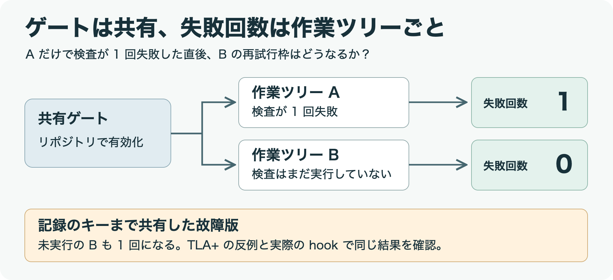

# レビュアーに何を伝えるか

**最初の一文で、誰にとって何が変わるかを伝える。** 次に、その変更が必要だった条件を書く。軽微な PR は本文 2〜3 行で十分。見出しを埋めるために説明を繰り返さない。

## 小さい変更の例

CI の環境変数を設定する場所だけを移した変更なら、確認先を一つ添える。[この例の差分](https://github.com/bwkw/dotagents/commit/2936a7756d3925f868924eec0f3da9cd1a8c8aaf)

```markdown
動画の CI は、ランナーが決まった後で依存の保存先を設定するようにしました。
確認箇所は media ジョブです。依存を導入する直前のステップが `$RUNNER_TEMP` を使います。
```

## 構造が変わる時の例

作業ツリー間の失敗回数の混同を検出する PR なら、レビューの問いは「片方で失敗した直後、もう片方には何回と出るか」。次の例は、そのまま読者が期待値とテストを照合できる形にしている。

ゲートの有効化は両方の作業ツリーに引き継がれます。A だけで検査が 1 回失敗したとき、B の失敗回数は 0 のままです。



[実装に同じ操作を与えるテスト](../../../scripts/test-worktree-isolation.mjs)では、故意に失敗回数を共有した版で B にも 1 回と表示されることを確認します。

## 足すとレビューの判断が変わる情報

| 読み手の疑問 | 本文に残すもの |
|---|---|
| どこから読むと確認できるか | 契約・分岐・移行順など、差分の中で判断が必要な一点と、その版の該当箇所 |
| なぜ別の方法を採らなかったか | 実際に検討した案と、退けた制約や測定結果。関連する issue・設計・実測へのリンク |
| 何が確かめられたか | 入力や条件と観測結果。性能値には比較条件を添える。人や実環境に残る確認は `- [ ]` で操作と理由を書く |

利用者や運用者にとって比較すべき変更が複数あれば、以下の 3 列を使う。各セルは値か短い句とし、純粋な追加の変更前は `—`。リポジトリの言語に合わせて見出しを訳す。

<!-- dotagents:change-table | 領域 | 変更前 | 変更後 | -->
| 領域 | 変更前 | 変更後 |
|---|---|---|
| CSV の日付 | 現地時刻 | UTC |
| API の日付 | — | UTC |

本人が書いた注意点や未確認事項は更新後も残す。一文を削っても読み手の確認先・判断が変わらなければ、その文は省く。
